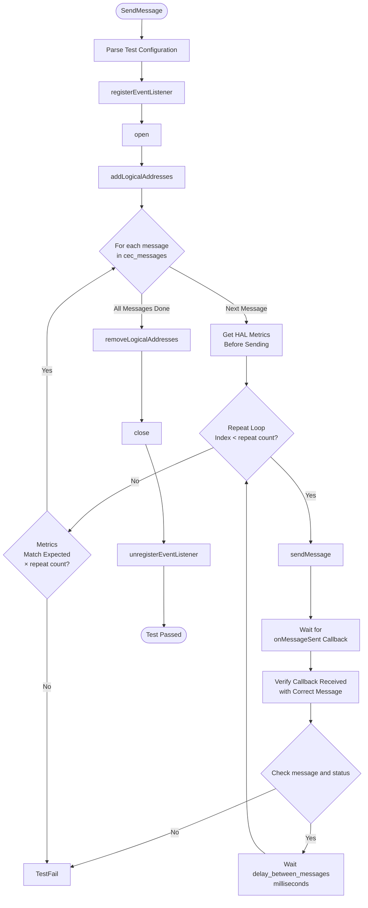
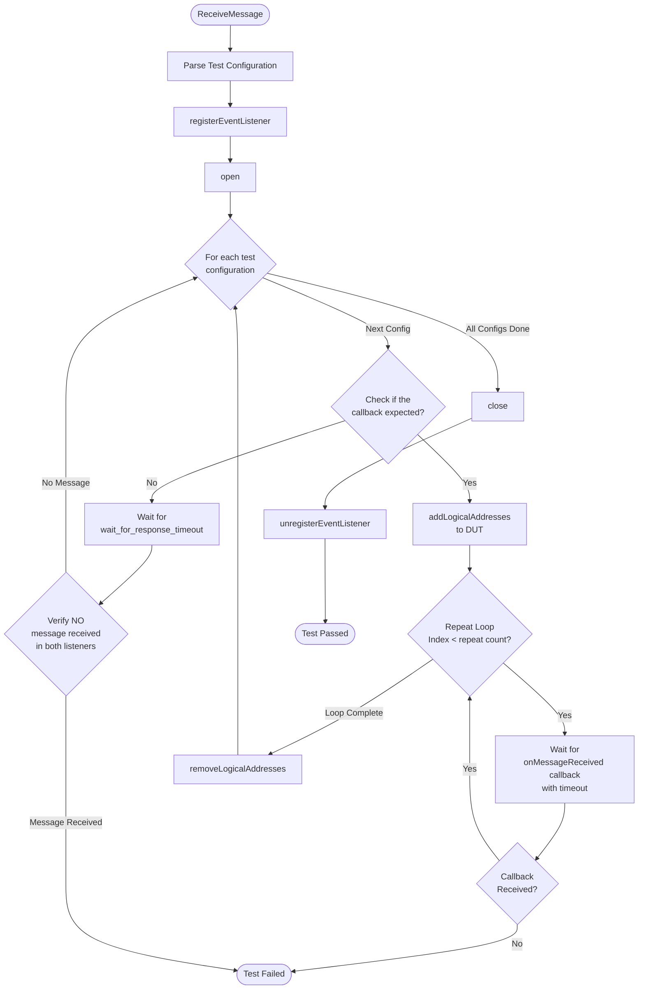

# HDMI CEC L3 Low Level Test Specification

## Table of Contents

- [Overview](#overview)
- [Acronyms, Terms and Abbreviations](#acronyms-terms-and-abbreviations)
- [References](#references)
- [Level 3 Test Specification](#level-3-test-specification)
    - [DUT Side Implementation](#dut-side-implementation)
    - [HOST Side Implementation](#host-side-implementation)

## Overview

This document defines the Level 3 (L3) Low-Level Test Specification for validating the `HDMI` Consumer Electronics Control (`CEC`) functionality in a device under test (`DUT`).
The objective of `L3` testing is to validate low-level, byte-accurate message transmission, receiving and `HAL` reported metrics through automated test execution using `VTS` and `RAFT` frameworks.

The goal is to ensure that:
- `CEC` messages are sent and received correctly.
- `CEC` `HAL` callbacks are triggered as expected.
- `HAL`-reported metrics accurately reflect bus activity.

### Acronyms, Terms and Abbreviations

- `HAL`    - Hardware Abstraction Layer
- `VTS`    - Vendor Test Suite
- `HDMI`   - High Definition Multimedia Interface
- `CEC`    - Consumer Electronics Control
- `L1`     - Level 1 Testing
- `L2`     - Level 2 Testing
- `L3`     - Level 3 Testing
- `DUT`    - Device Under Test
- `RAFT`   - Rapid Automation Framework for Testing
- `YAML`   - YAML Ain't Markup Language
- `AIDL`   - Android Interface Definition Language
- `controller` - CEC message peer (vDevice/vComponent or hardware adaptor such as Pulse-Eight)

### References

- `High Level Test Specification` - [hdmicec_High-Level_TestSpecification.md](hdmicec_High-Level_TestSpecification.md)
- [CEC AIDL interface](https://github.com/rdkcentral/rdk-halif-aidl/tree/0.12.0/cec/)

## Level 3 Test Specification

### `DUT` Side Implementation

The `VTS` binary running on the DUT provides two key L3 capabilities:

- SendMessage - Transmit `CEC` frames and validate `HAL` metrics
- ReceiveMessage - Receive `CEC` frames and validate `HAL` callback behavior

#### SendMessage

##### Objective

To verify that the `DUT`:
- Set logical address as defined in the test config.
- For each item in `cec_messages`:
    - Transmit the message exactly repeat times.
    - Wait `delay_between_messages` milliseconds before each transmission.
- Validates the `HAL` metrics for `onMessageSent` callbacks

##### Flow



##### Configuration File (YAML)

`SendMessage` uses the following test configuration file to send the messages:

```yaml
HdmiCec:
  L3:
    SendMessage:  # Test name
      source_logical_address: [0] # Assign logical address ‘0’ to DUT
      delay_between_messages: 100 # delay between each sendMessage in msec
      cec_messages:
      - Parameters:
          message: ['0x05', '0x47', '0x52', '0x44', '0x4B', '0x20', '0x76', '0x44',
            '0x65', '0x76', '0x69', '0x63', '0x65', '0x20', '0x54', '0x56']
          repeat: 5 # Number of times the message to be sent
        Expected_Results:
          metrics: {directedMessagesSent: 1, directedMessagesSentAndAcked: 1, broadcastMessagesSent: 0,
            broadcastMessagesSentAndAcked: 0, arbitrationFailures: 0} # metrics per message
```
- **source_logical_address:** List of logical address assigned to `DUT` before sending messages.
- **delay_between_messages:** Delay between consecutive transmissions in milliseconds
- **cec_messages:** List of `CEC` messages to send to the `controller`
- **message:** List of `CEC` bytes to be sent to the `controller`
- **repeat:** Number of times the `DUT` must transmit the message.
- **metrics:** Expected metrics reported by the `HAL` for each sent message

#### ReceiveMessage

##### Objective

The purpose of the `ReceiveMessage` Level 3 test is to verify that the `DUT` correctly receives `CEC` messages sent by the `controller` and that the `HAL` delivers these messages to the framework via callbacks. Specifically, the test ensures that:

- The `DUT` is assigned each logical address provided in the configuration.
- The controller sends the configured message to the `DUT`.
- The `HAL` triggers `onMessageReceived` with the exact payload.
- Callbacks occur exactly repeat times.
- The callback is not triggered when the destination address does not match the `DUT` or no logical address is assigned to `DUT`.

##### Flow



##### Configuration File (YAML)

`ReceiveMessage` uses the following test configuration file to receive messages:

```yaml
HdmiCec:
  L3:
    ReceiveMessage:
    - Parameters:
        message: ['0x41', '0x47', '0x52', '0x44', '0x4B', '0x20', '0x76', '0x44',
          '0x65', '0x76', '0x69', '0x63', '0x65', '0x20', '0x54', '0x56']
        repeat: 5
        logical_address: [0, 3, 10] # Assign logical address to DUT
        wait_for_response_timeout: 5000
```

- **message:** List of `CEC` frame bytes sent by the `controller` to the `DUT`
- **logical_address:** List of logical address assigned to `DUT` before sending messages.
- **repeat:** Number of times the `DUT` must receive the same message
- **wait_for_response_timeout:** wait time for the callbacks

### Host Side Implementation

`RAFT` automates communication, synchronization, and verification between the `controller` and the `DUT`.

#### Send Message Test

**Purpose:** Validates that the `DUT` can successfully send `HDMI-CEC` messages and that the `HAL` generates the correct callbacks and metrics.

**Test Flow:**
- Deploy VTS binaries to DUT.
- Initialize and configure RAFT CEC controller.
- Send CEC messages from `DUT` → `Controller`.
- Verify that:
  - HAL callbacks are triggered correctly.
  - The message is received at the expected destination device.
  - Metrics match expected counts.

#### Receive Message Test

**Purpose:**
Validate DUT’s ability to receive CEC frames correctly.

**Test Flow:**

- Deploy VTS binaries to DUT.
- Configure the `CEC` device network.
- Send `CEC` messages from `Controller` → `DUT`.
- Validate the following scenarios:
  - Positive cases: HAL callback is triggered when:
    - A valid logical address is assigned to the DUT, and
    - The CEC message destination matches the DUT or a broadcast messages received.
  - Negative cases: No HAL callbacks when:
    - DUT has no logical address assigned.
    - Message destination is different from the DUT’s logical address.

