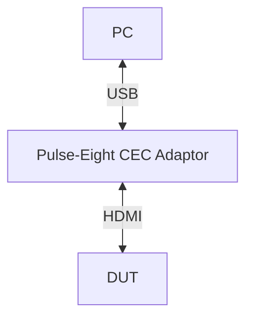

# HdmiCec L1, L2, L3 Test Procedure

## Table of Contents
- [Acronyms, Terms and Abbreviations](#acronyms-terms-and-abbreviations)
- [Build the VTS](#build-the-vts)
- [Run L1 L2 Tests Without Python](#run-l1-l2-test-without-python)
- [Run Tests in Python Environment](#run-tests-in-python-environment)
  - [Update Configuration Files](#update-configuration-files)
  - [Install the Python Packages](#install-the-python-packages)
  - [Run the Tests](#run-test-cases)
- [Notes](#note)

## Acronyms, Terms and Abbreviations

- `HAL`    - Hardware Abstraction Layer
- `VTS`    - Vendor Test Suite
- `HDMI`   - High Definition Multimedia Interface
- `CEC`    - Consumer Electronics Control
- `L1`     - Level 1 Testing
- `L2`     - Level 2 Testing
- `L3`     - Level 3 Testing
- `DUT`    - Device Under Test
- `RAFT`   - Rapid Automation Framework for Testing
- `YAML`   - YAML Ain't Markup Language
- `AIDL`   - Android Interface Definition Language

## Build the VTS

### Build Linux binder

The test suite depends on the Linux binder with `AIDL` support. Follow these steps to build it:

For detailed build instructions, please refer to [Linux Binder](https://github.com/rdkcentral/linux_binder_idl/tree/1.0.0)

Here are the simplest steps outlined:

```bash
git clone -b develop 'https://github.com/rdkcentral/linux_binder_idl.git'

cd linux_binder_idl

./build-linux-binder-aidl.sh 64
```

### Build VTS binaries

Clone and build the test suite:

```bash
git clone git@github.com:rdkcentral/rdk-halif-aidl-test-cec.git
```

```bash
cd rdk-halif-aidl-test-cec
```

Set the following environment variables:

- AIDL_BIN: Path to the `AIDL` compiler (e.g., /path/to/linux_binder_idl/out/aidl).

- LINUX_BINDER_OUT_DIR: Path to the Linux binder output directory (e.g., /path/to/linux_binder_idl/local).

- UT_CORE_VERSION: Specific version of the UT-Core framework (e.g., 4.7.0). Defaults to the latest tagged version.

- VCOMPONENT_HDMI_CEC_VERSION: Specific version of the HDMI CEC Virtual Component (e.g., 1.0.0). Defaults to the latest HEAD.

- RDK_HALIF_AIDL_VERSION: Specific version of the AIDL HAL Specification (e.g., 0.12.0). Defaults to the latest HEAD.

Example:

```bash
export UT_CORE_VERSION=5.0.0
export RDK_HALIF_AIDL_VERSION=0.12.0
export VCOMPONENT_HDMI_CEC_VERSION=0.2.0
export AIDL_BIN=/path/to/linux_binder_idl/out/aidl
export LINUX_BINDER_OUT_DIR=/path/to/linux_binder_idl/local/
```

By default, `UT` logs are disabled. To enable them, set the following environment variable:

```bash
export ENABLE_UT_INFO_LOGGING=1
```

Run the build script:

```bash
./build.sh Target=<Target-name>

# Supported Targets: linux, arm
```

The build.sh script:

- Clones the `rdk-halif-aidl` repository and UT-Core framework.
- Compiles the test suite.
- Generates binaries in the `build/bin` directory.
- Generates tar file `vts-HdmiCec.tar.gz` in the `build/bin` directory.

## Run L1 L2 Test Without Python

### Transfer Tar File to Target Device

Copy the `vts` binaries (`vts-HdmiCec.tar.gz`) to the target device (e.g., using `scp`):

```bash
scp -P <port> vts-HdmiCec.tar.gz root@target-device:/tmp/
```

### Extract on Target Device

Log into the target device and extract the tarball:

```bash
ssh root@target-device
mkdir /tmp/HdmiCec
tar -zxf vts-HdmiCec.tar.gz -C /tmp/HdmiCec
cd /tmp/HdmiCec
```

### Run the VTS Test on Target Device

Run the following command to execute the VTS test:

```bash
./run.sh -p profiles/hfp-hdmicec_vcomponent.yaml
```

## Run Tests in Python Environment

### Update Configuration Files

#### Rack Configuration File

Example Rack configuration File: [vts_rack_configuration.yml](../../host/configs/vts_rack_configuration.yml)

For more details on rack configuration refer [RAFT](https://github.com/rdkcentral/python_raft/blob/1.8.0/README.md) and [example_rack_config.yml](https://github.com/rdkcentral/python_raft/blob/1.8.0/examples/configs/example_rack_config.yml)

In this file, update the configuration to define the console sessions for the `DUT` and the outbound settings:

|Console Session|Description|
|---------------|-----------|
|default|This session is used for basic operations, such as verifying the device status and retrieving the MAC address|
|ssh_hal_test|Executes the `HAL` binary for the test case|
|ssh_hal_test_1|Console to control CEC device|

```yaml
rackConfig:
    rack1:
        name: "rack1"
        description: "example config at my desk"
        slot1:
            name: "slot1"
            devices:
                - dut:
                    ip: ""  # IP Address of the ADA Hub
                    description: "PC"
                    platform: "vDevice"
                    consoles:
                        - default:
                            type: "ssh"
                            port: 5522
                            username: "root"
                            ip: "" #IP address
                            password: ""
                            prompt: "~#" # Prompt string on console
                        - ssh_hal_test:
                            type: "ssh"
                            port: 5522
                            username: ""
                            ip: "" #IP address
                            password: ""
                            prompt: "~#" # Prompt string on console
                        - ssh_hal_test_1:
                            type: "ssh"
                            port: 5522
                            username: ""
                            ip: "" #IP address
                            password: ""
                            prompt: "~#" # Prompt string on console
                    outbound:
                        download_url: "tftp://tftp-server.com/rack1/slot1/"    # download location for the CPE device
                        upload_url: "sftp://server-address/home/workspace/tftp/rack1/slot1/" # upload location
                        upload_url_base_dir: "sftp://server-address/home/workspace/tftp/rack1/slot1" # alternative upload location
                        httpProxy:    # Local Proxy if required
                        workspaceDirectory: './logs/workspace'   # Local working directory
                    hdmiCECController:
                        type: virtual-cec-client # Controller name
                        vendor: "vComponent" # Vendor optional
                        address: "127.0.0.1" # Needs to be be filled out with IP address
                        username: ""         # Needs to be filled out with login username
                        password: ''         # Needs to be filled out with login password
                        port: 5522           # Needs to te filled out with port number
                        control_port: 8080   # ut controller port
                        device_network_configuration: "/home/hdmicec_device_config_add_network.yaml" # Virtual hdmi device network configuration file
```

***hdmiCECController:***
Configure this field according to your test platform. For physical hardware testing, use real CEC clients (e.g., `remote-cec-client`). For virtual device testing, use `virtual-cec-client`. For virtual device provide the connection details of the device running vComponent.
- `control_port` - The port number where vComponent accepts command requests.
- `device_network_configuration` - Configuration file with host path for the virtual HDMI device network.

For additional information about the CEC vComponent, see: [HDMI CEC Virtual Component](https://github.com/rdkcentral/rdk-aidl-vcomponent-cec/blob/0.1.0/README.md)

#### Device Configuration File

Example Device configuration File: [vts_device_configuration.yml](../../host/configs/vts_device_configuration.yml)

For more details refer [RAFT](https://github.com/rdkcentral/python_raft/blob/1.7.0/README.md) and [example_device_config.yml](https://github.com/rdkcentral/python_raft/blob/1.7.0/examples/configs/example_device_config.yml)

Ensure the `platform` should match with the `DUT` platform in [Rack Configuration](#rack-configuration-file)

```yaml
deviceConfig:
    cpe1:
        platform:   "vDevice" # Platform which is specified under DUT in rack configuration
        model:      "VTV"     # Model (optional)
        soc_vendor: "intel"   #soc vendor
        target_directory: "/tmp/" # Directory on target to which binaries will be copied
        device_type: ["TV"] # Possible values: ["TV", "RecordingDevice", "Tuner", "PlaybackDevice", "AudioSystem", "VideoProcessor", "PureCecSwitch", "Reserved"]
        prompt: "~#" # Prompt string on console
        wait_time: 240 # Configurable timeout value to limit the total duration of individual tests
        test:
            profile: "../../profiles/hfp-hdmicec_vcomponent.yaml" #HFP profile used to meet platform requirements
            device_network_list: "/tmp/hdmi_cec_device_list_info.txt" #File path where the connected HDMI CEC device list is stored
```

### Install the Python Packages

[host](../../host/) folder contains the script files to install required packages and set up the Python environment.

- Run install.sh once to create the virtual environment
- source activate_venv.sh
- Run install.sh again to install dependencies inside the environment.

Run the following commands:

```bash
./install.sh
source activate_venv.sh
./install.sh
```

For more details refer [Python Set up](https://github.com/rdkcentral/ut-raft/wiki/Guide-for-Setting-up-the-Python-RAFT-Testing-Suite) and [Raft Setup](https://github.com/rdkcentral/python_raft/?tab=readme-ov-file#installation)

### Run Test Cases

#### L1 and L2

Once the environment is set up, execute the test cases with the following command:

```bash
python vts_hdmicec_L1_L2_tests.py --config </PATH>/host/tests/configs/vts_rack_configuration.yaml --deviceConfig </PATH>/host/tests/configs/vts_device_configuration.yaml
```

#### L3

##### Device Setup

###### vDevice

For vDevice, no external hardware needs to be connected to the setup.

###### Real Device

The picture below depicts the HDMI CEC L3 Test Functionality Setup. This simple setup has an HDMI CEC Pulse-eight USB adaptor, which acts as a source device and can send the required commands (using `libcec` tool commands) and respond to the received CEC Commands.



###### Pulse-Eight CEC Adaptor Tool

The Pulse-Eight CEC adaptor is used to frame and send commands to the DUT. It utilizes the `libCEC` library for `HDMI CEC` activities, and the `cec-client` tool plays a key role in test automation within RAFT.

- Adaptor Details: [Pulse Eight](https://www.pulse-eight.com/p/104/usb-hdmi-cec-adapter)

`RAFT` supports the following `CEC` controllers:

- Remote Controller: For adaptors connected to a remote server, use the configuration below:
- Local Controller: For adaptors connected directly to the server running the tests, use the configuration below:

For more details on controller configuration, refer [example_rack_config.yml](https://github.com/rdkcentral/python_raft/blob/1.7.1/examples/configs/example_rack_config.yml)
##### Run Tests

Once the environment is set up, execute the test cases with the following command:

```bash
python <testcase>.py --config </PATH>/host/tests/configs/vts_rack_configuration.yaml --deviceConfig </PATH>/host/tests/configs/vts_device_configuration.yaml
```

### L3 Test Cases

#### Send Message Test — `vts_hdmicec_L3_SendMessage.py`

**Path:** [vts_hdmicec_L3_SendMessage.py](../../host/tests/vts_hdmicec_L3_SendMessage.py)

**Purpose:** Validates that the `DUT` can successfully send `HDMI-CEC` messages and that the `HAL` generates the correct callbacks and metrics.

**Test Flow:**
- Copy the VTS binaries to the target device.
- Configure the CEC device network.
- Send CEC messages from `DUT` → Controller.
- Verify that:
  - HAL callbacks are triggered correctly.
  - The message is received at the expected destination device.
  - HAL metrics are generated as expected.

#### Receive Message Test — `vts_hdmicec_L3_ReceiveMessage.py`

**Path:** [vts_hdmicec_L3_ReceiveMessage.py](../../host/tests/vts_hdmicec_L3_ReceiveMessage.py)

**Purpose:**
Validates whether the `DUT` correctly receives `CEC` messages and generates HAL callbacks only when appropriate

**Test Flow:**

- Copy the `VTS` binaries to the target device.
- Configure the `CEC` device network.
- Send `CEC` messages from Controller → `DUT`.
- Validate the following scenarios:
  - Positive cases: HAL callback is triggered when:
    - A valid logical address is assigned to the DUT, and
    - The CEC message destination matches the DUT or a broadcast messages received.
  - Negative cases: No HAL callbacks when:
    - DUT has no logical address assigned.
    - Message destination is different from the DUT’s logical address.

## Note

### Test Setup on vDevice

To validate automation on vDevice, create a password for the root user using the following command:

```bash
passwd root
```

Then, update the same password in the `vts_rack_configuration.yaml` file.

Currently, the Python `paramiko` library does not support empty passwords on vDevice, so setting a password is necessary.

### Run on Windows Environment

To run the Python environment tests in a Windows environment, follow these additional steps after checking out the repository and compiling the code:

1. Install the python environment and update the rack configuration files as in the Linux environment.

2. Move the entire project folder (including `host`) to the Windows machine.

3. Open the file located at `framework/plugins/ut_raft/interactive_shell.py`.

   - Comment out or remove the following import lines to avoid errors on Windows:
     ```python
     import pty
     import fcntl
     ```

4. After these changes, run the test cases using Python on the Windows system.
